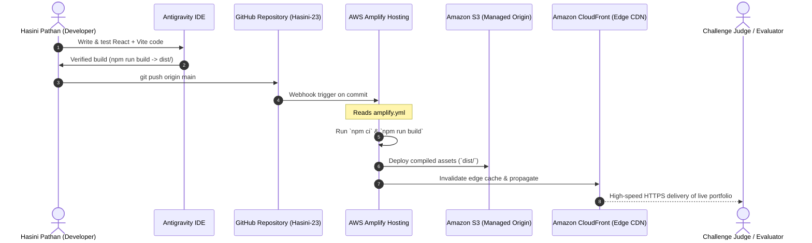

# AWS Architecture & Hosting Specification
**Project:** Hasini Pathan Personal Cloud Portfolio  
**Challenge:** AWS Student Builder Challenge 2026  
**Hosting Environment:** AWS Amplify Hosting  

---

## 1. AWS Services Actually Used

In alignment with hackathon guidelines, this project strictly documents the AWS services genuinely utilized for hosting and distribution:

| AWS Service | Exact Function in Project |
| :--- | :--- |
| **AWS Amplify Hosting** | Manages the full Continuous Integration & Continuous Deployment (CI/CD) pipeline, builds the Vite production bundle, and provisions high-availability web hosting. |
| **Amazon CloudFront** | Automatically provisioned by AWS Amplify to serve static web assets (`dist/`) across global edge locations with low latency and high transfer speeds. |
| **Amazon Simple Storage Service (S3)** | Serves as the managed static asset origin storage backing Amplify's distribution network. |
| **AWS Certificate Manager (ACM)** | Automatically provisions, manages, and renews SSL/TLS certificates for HTTPS encryption. |

> [!NOTE]
> No unneeded or fabricated backend services (such as unconfigured Lambda functions or DynamoDB tables) were added, ensuring a lean, cost-efficient, and authentic student architecture.

---

## 2. End-to-End Architecture Diagram



---

## 3. Amplify Build Configuration (`amplify.yml`)

The repository root contains the exact build specification used by AWS Amplify:

```yaml
version: 1
frontend:
  phases:
    preBuild:
      commands:
        - npm ci
    build:
      commands:
        - npm run build
  artifacts:
    baseDirectory: dist
    files:
      - '**/*'
  cache:
    paths:
      - node_modules/**/*
```

### Build Workflow Breakdown:
1. **`preBuild`:** Runs `npm ci` to install dependencies deterministically based on `package-lock.json`.
2. **`build`:** Runs `npm run build` via Vite, compiling JSX, CSS, and assets into minified JavaScript and CSS chunks.
3. **`artifacts`:** Instructs Amplify to take all files from the `dist/` directory and deploy them to the hosting bucket.
4. **`cache`:** Caches `node_modules` across builds to reduce subsequent deployment times to under 60 seconds.

---

## 4. Security & Zero-Secrets Compliance

- **No Hardcoded Credentials:** The project does not include, request, or expose AWS access keys, secret keys, IAM credentials, or sensitive tokens.
- **Git Provider Integration:** Amplify connects directly via GitHub's OAuth app authorization, keeping repository credentials secure.
- **Client-Side Safety:** No backend API keys are embedded in client bundles; contact requests use direct browser `mailto:` drafts.
